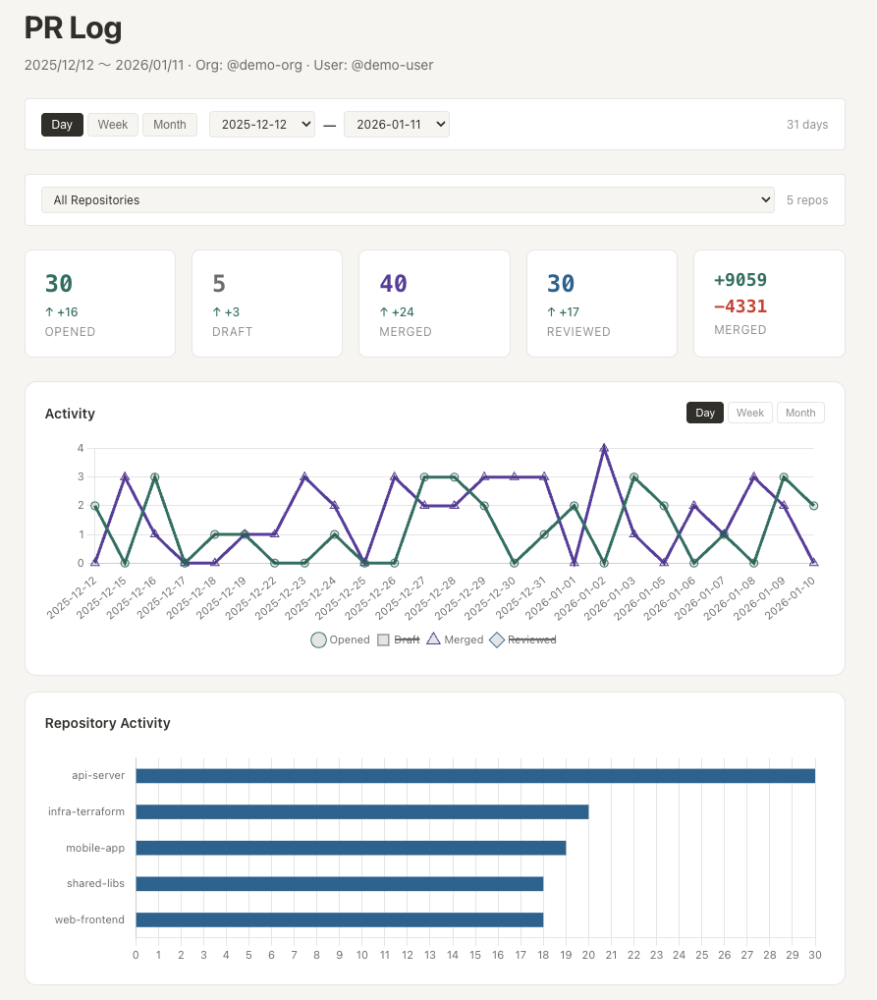

# shiraberu

[](https://github.com/taikicoco/shiraberu/actions/workflows/ci.yml)
[](https://pkg.go.dev/github.com/taikicoco/shiraberu)

A CLI tool to track and report your GitHub PR contributions within an organization.

## Demo

<p align="center">
  
</p>

## Features

- Display PRs you opened, merged, or reviewed by day
- Separate Draft PRs from regular PRs
- Show code changes (additions/deletions) and comment counts
- Support for HTML, Markdown, and browser output
- Fast data fetching via GitHub GraphQL API

## Requirements

- Go 1.24+
- [GitHub CLI](https://cli.github.com/) (`gh`) - authenticated

## Installation

```bash
go install github.com/taikicoco/shiraberu@latest
```

## Usage
```
shiraberu
```

### Without prompts

Pass `-since` to skip the prompts and write your activity as JSON.

```bash
shiraberu -org your-org -since 2026-05-01 -until 2026-05-31 > activity.json
```

| Flag | Description | Default |
| --- | --- | --- |
| `-since` | Start date (`YYYY-MM-DD`, JST) | Required |
| `-until` | End date (`YYYY-MM-DD`, JST) | Same as `-since` |
| `-org` | GitHub organization | `SHIRABERU_ORG` |
| `-user` | GitHub username | The authenticated user |
| `-format` | Output format. Only `json` is supported | `json` |
| `-output` | Output file path | stdout |

Each item in `activities` is one thing you did on a pull request.

| `type` | `occurredAt` | Notes |
| --- | --- | --- |
| `created` | When you opened the PR | Any state, including merged and closed PRs |
| `merged` | When your PR was merged | |
| `closed` | When your PR was closed without merging | |
| `reviewed` | When you submitted the review | One item per review, with `reviewState`, `url` and `body`. Reviews on your own PRs are not included |
| `commented` | When you posted the comment | One item per conversation comment, with `url` and `body`. Comments on your own PRs are not included |

Limitations: inline review comments are not included, only the latest 100 conversation comments of each PR are checked, and the command stops with an error if a search matches more than 1,000 PRs.
- [godoc](https://pkg.go.dev/github.com/taikicoco/shiraberu)
